

  &#8287;&#8287;&#8287;&#8287;&#8287;

  &#8287;&#8287;&#8287;&#8287;&#8287;

  &#8287;&#8287;&#8287;&#8287;&#8287;

  &#8287;&#8287;&#8287;&#8287;&#8287;

  &#8287;&#8287;&#8287;&#8287;&#8287;

 

 

  
<h2>🌠 Top Sponsors</h2>

  <table><tr><th>极算悦智</th></tr><tr><td align="center">
  <a href="https://jisuan.super.tose.asia/">&nbsp;&nbsp;<strong>VALIORA</strong></a>
  </td></tr></table>

  

  
<h2>📘 My Projects &amp; Research</h2>

  

    <a href="https://github.com/xiao222xian/fuyao-zhiyuan-platform">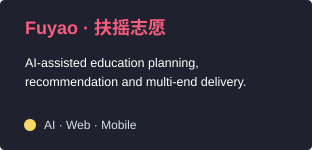</a>
    <a href="https://github.com/xiao222xian/audio-memory-research-notes">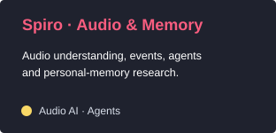</a>
    <a href="https://github.com/xiao222xian/ai-application-lab">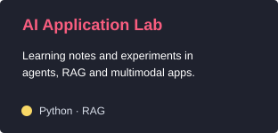</a>
    <a href="https://github.com/xiao222xian/ted-multiagent-research-notes">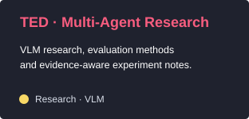</a>
    <a href="https://github.com/xiao222xian/aicoo-name-card">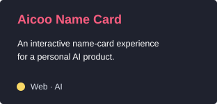</a>
    <a href="https://github.com/xiao222xian/pet-health-app">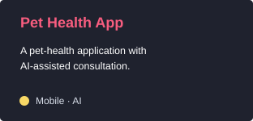</a>
    <a href="https://github.com/xiao222xian/foga-miniapp-design-share">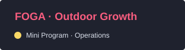</a>
    <a href="https://github.com/xiao222xian/hua-yu-shou-design-share">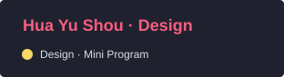</a>
    <a href="https://sam.super.tose.asia/">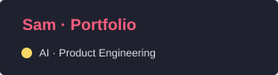</a>
  

  

  
<h2>📕 Projects I've Worked On</h2>

  

    <a href="https://www.aicoo.io/">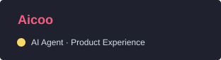</a>
    
    <a href="https://github.com/xiao222xian/fuyao-zhiyuan-platform">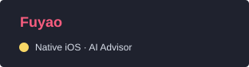</a>
    <a href="https://github.com/xiao222xian/audio-memory-research-notes">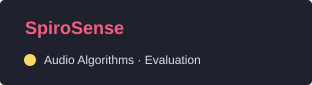</a>
    
    <a href="https://sam.super.tose.asia/#project">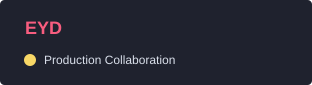</a>
    
    <a href="https://sam.super.tose.asia/#project">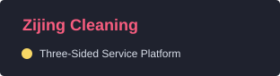</a>
    <a href="https://sam.super.tose.asia/#project">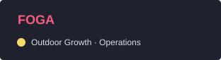</a>
  

  

  
<h2>📺 Latest Videos</h2>

  

  
视频入口待补充。保留参考页的六卡片排版，不将他人的视频作为本人作品。

  
<h2>🛠️ My Favorite Tools</h2>

  <h3>👨‍💻 Programming and Markup Languages</h3>
  

  <h3>🧰 Frameworks and Libraries</h3>
  

  <h3>🗄️ Databases and Cloud Hosting</h3>
  

  <h3>💻 Software and Tools</h3>
  

  
<h2>📊 Stats and Activity</h2>

  <h3>🔥 Streak Stats</h3>
  

  <h3>💻 GitHub Profile Stats</h3>
  
  
   
  <b>Note:</b> Language statistics describe public repository code, not experience or skill level. Private project source remains private.

  
<a href="https://github.com/xiao222xian?tab=overview">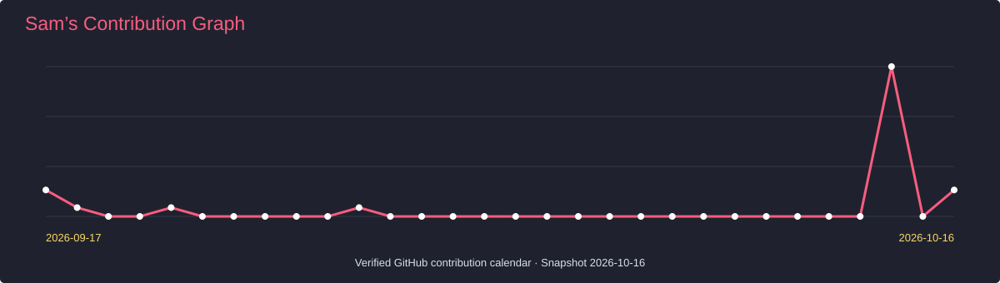</a>

  <h3>⚡ Recent GitHub Activity</h3>
  
<a href="https://github.com/xiao222xian?tab=overview">View my real GitHub activity →</a>

  
<h2>🏷️ Achievement Board</h2>

  

  
Profile links &amp; pending content / 待补充内容

  
Verified links: <a href="https://github.com/xiao222xian">GitHub</a> · <a href="https://sam.super.tose.asia/">Portfolio</a> · <a href="https://jisuan.super.tose.asia/">Valiora</a>.

  
YouTube、LinkedIn、X、Discord、Dev.to、Ko-fi、视频和成就暂为待确认位置；不是对账号归属或个人荣誉的声明。Sponsor 区展示本人的公司极算悦智（VALIORA），链接至公司官网。

Layout reference: <a href="https://github.com/DenverCoder1">DenverCoder1</a> · Pink typing SVG, icon spacing, badge palette and project-card dimensions follow the reference. <a href="ATTRIBUTION.md">Credits</a>.

